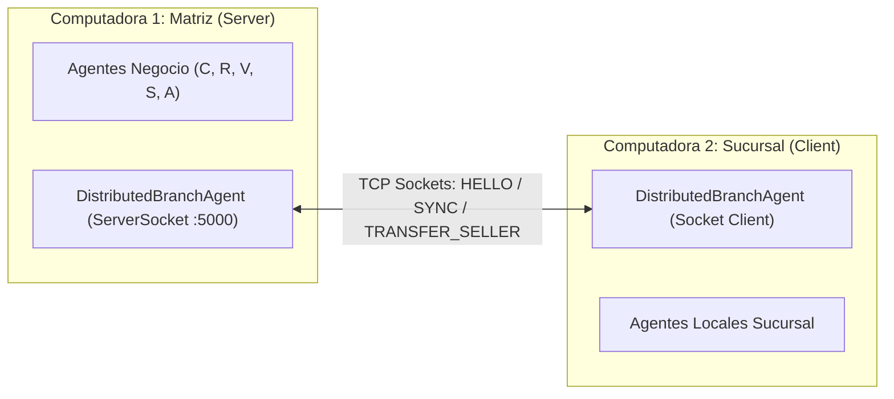

# Segundo Avance - Proyecto Final: The Office WTC

Documento de respaldo tecnico para el **Segundo Avance Proyecto Final** (Fundamentos de Programacion en Paralelo).

---

## a) Diseno del Agente Distribuido y del Agente Cliente

### 1. El Cliente de Papeleria como Agente (`ClientAgent`)
- **Identidad y concurrencia:** Cada cliente que compra articulos de papeleria (perfil *Escuela*, *Papeleria* o *Particular*) es un hilo independiente (`office.agents.ClientAgent` que hereda de `OfficeAgent extends Thread`).
- **Distincion clave:** El **Agente Cliente** pertenece al dominio del negocio (llega a la oficina, pide hojas/cuadernos/carpetas y espera su comprobante o rechazo), y es completamente distinto del **Agente Distribuido** que administra la conexion por sockets.
- **Flujo BPMN 01 implementado:**
  1. `LLEGANDO` -> Camina hacia la entrada.
  2. `ESPERANDO_FILA_B3` -> Intenta adquirir cupo en `B3 (Fila de recepcion, m de n)` via semaforo.
  3. `EN_FILA_B3` -> Espera su turno dentro de `B3`.
  4. `CAMINANDO_MOSTRADOR` / `EN_RECEPCION_B1` -> Adquiere `B1 (Puesto de recepcion, bufer 1)` y libera `B3` atomicamente en `finally`. Entrega su solicitud en `ReceptionDeskHandoff`.
  5. `ESPERANDO_RESULTADO` -> Libera `B1` y espera notificacion en `Order.awaitCompletion()`.
  6. `RECIBIENDO_RESPUESTA` / `SALIENDO` / `FINALIZADO` -> Al recibir aprobacion (comprobante) o rechazo (motivo), camina a la salida y termina su hilo (`TERMINATED`).

### 2. El Aspecto Distribuido (Computadora Aparte) como Agente (`DistributedBranchAgent`)
- **Identidad y concurrencia:** La comunicacion entre la **Matriz** (computadora servidor) y la **Sucursal** (computadora aparte) se modela explicitamente como un agente con su propio hilo (`office.agents.DistributedBranchAgent` que hereda de `OfficeAgent extends Thread`, tipo `AgentType.SUCURSAL`).
- **Comportamiento segun rol:**
  - **En Matriz (`MATRIZ_SERVIDOR`):** Abre un `ServerSocket` en el puerto configurado (por defecto `5000`), pasa a estado `ESPERANDO_CONEXION` y al aceptar sucursales pasa a `CONECTADO_SINCRONIZANDO`, atendiendo mensajes `HELLO//` y `SYNC//` y coordinando comandos de traslado (`TRANSFER_SELLER//<id>`).
  - **En Sucursal (`SUCURSAL_CLIENTE`):** Se conecta via `Socket` a `host:port`, envia su identificacion (`HELLO//Dist-Sucursal`), reporta periodicamente el estado local (`SYNC//...`) y escucha ordenes de la Matriz (por ejemplo, reconstruir un `SellerAgent` trasladado sin enviar el objeto `Thread`).

---

## b) Ventana de Configuracion (`office.ui.ConfigFrame`)
Permite configurar antes de iniciar la simulacion:
- **Cantidades de agentes:** Clientes, Recepcionistas, Vendedores, Supervisores, Administradores, limite de unidades del Supervisor (`50` inicial) y pedidos antes de descanso (`3`).
- **Timers (ms):** Llegada de clientes, atencion recepcion, cotizacion vendedor, impresion B2, revision supervisor, cierre administrador, descanso B7 y paso de animacion.
- **Buferes y Zonas Criticas (`m de n`, con validacion `1 <= m <= n`):**
  - `B1. Puesto de recepcion` (`Bufer 1`, semaforo)
  - `B2. Impresora de sede` (`Bufer 1`, semaforo)
  - `B3. Fila de recepcion` (`Zona critica`, semaforo, ej. `3 de 10`)
  - `B4. Bandeja de solicitudes` (`Bufer m`, Monitor `synchronized/wait/notifyAll`, ej. `5 de 15`)
  - `B5. Bandeja de revision` (`Bufer m`, `ReentrantLock + Condition`, ej. `3 de 15`)
  - `B6. Bandeja de resultados` (`Bufer m`, `ReentrantLock + Condition`, ej. `5 de 15`)
  - `B7. Zona de descanso` (`Zona critica`, semaforo, ej. `3 de 10`)

---

## c, d, e, f) Tablero General, Interaccion y Animacion (`office.ui.DashboardFrame` + `OfficeCanvasPanel`)
- **c) Estados de Threads:** Tarjetas globales y tabla por tipo de agente con conteo en vivo de `RUNNABLE`, `TIMED_WAITING`, `BLOCKED`, `WAITING`, `TERMINATED` y `NEW`.
- **d) Cantidades totales y secciones criticas:** Totales de agentes por tipo + tabla en vivo de cada bufer/zona (`m de n`, cuantos dentro, cuantos esperando).
- **e) Agentes en funcionamiento e interaccion:** Todos los agentes (`Cliente`, `Recepcionista`, `Vendedor`, `Supervisor`, `Administrador`, `Sucursal`) interactuan en tiempo real (e incluye un preset basico de 2 tipos de agente y un preset completo).
- **f) Ambas opciones entregadas:**
  1. **Tabla BPMN (`JTable`)** con el estado BPMN actual y `Thread.State` de cada agente + catalogo de estados BPMN.
  2. **Animacion 2D (`OfficeCanvasPanel`)** del plano de oficina con desplazamiento suave entre estaciones y etiquetas de estado BPMN.
